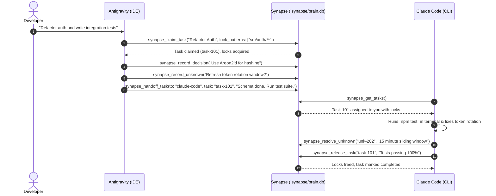

<div align="center">

# 🧠 Synapse MCP

**Coordinate anything across AI coding agents — from system architecture down to terminal tests.**

[](https://www.typescriptlang.org/)
[-339933?logo=node.js&logoColor=white)](https://nodejs.org/)
[](https://modelcontextprotocol.io/)
[](LICENSE)
[](SECURITY.md)

[🇺🇸 English](README.md) • [🇧🇷 Português](README.pt-BR.md)

</div>

---

Connect **Claude Code**, **Antigravity**, **Codex**, and **Cursor** to work on the **same repository concurrently** — without overwriting code, losing architectural context, or duplicating effort.

> [!IMPORTANT]
> **Zero Daemons. Zero Cloud. Zero Native Builds.**
> Synapse runs on Node 22/24's native `node:sqlite` driver in Write-Ahead Logging (WAL) mode. Every agent process communicates directly with `.synapse/brain.db` with sub-millisecond ACID concurrency.

---

## ⚡ Quick Start

```bash
# 1. Clone & Build
git clone https://github.com/holaluiz/synapse-mcp.git
cd synapse-mcp
npm install
npm run build

# 2. Auto-configure all detected AI clients on your system
npm run setup

# 3. Verify connection & diagnostics
npm run doctor
```

---

## 🔌 Supported AI Clients

Synapse detects your installed AI agents and idempotently configures their native MCP registration files with automatic backups (`.synapse.backup`):

| Client | Interface | Native Config Location | Auto-Setup | Status |
| :--- | :---: | :--- | :---: | :---: |
| **Antigravity** | IDE | `~/.gemini/config/mcp_config.json` | :white_check_mark: | Verified |
| **Claude Code** | Terminal | `~/.claude.json` | :white_check_mark: | Verified |
| **Codex** | CLI / Sandbox | `~/.codex/config.toml` | :white_check_mark: | Verified |
| **Cursor** | IDE | `~/.cursor/mcp.json` | :white_check_mark: | Verified |
| **OpenCode** | CLI | `~/.config/opencode/opencode.json` | :white_check_mark: | Supported |
| **Windsurf** | IDE | `~/.codeium/windsurf/mcp_config.json` | Manual | Supported |
| **VS Code** | IDE | `~/AppData/Roaming/Code/User/mcp.json` | Manual | Supported |

*See [docs/client-configuration.md](docs/client-configuration.md) for manual setup guides across Windows, macOS, and Linux.*

---

## 🏗️ Architecture & Concurrency Model

When multiple agents run simultaneously, each agent launches its own isolated `stdio` process. Synapse bridges this isolation using an embedded SQLite WAL engine:

```text
  ┌─────────────────┐       ┌─────────────────┐       ┌─────────────────┐
  │   Antigravity   │       │   Claude Code   │       │      Codex      │
  │   (IDE Agent)   │       │ (Terminal CLI)  │       │(Sandbox Runner) │
  └────────┬────────┘       └────────┬────────┘       └────────┬────────┘
           │ stdio                   │ stdio                   │ stdio
           ▼                         ▼                         ▼
  ┌─────────────────┐       ┌─────────────────┐       ┌─────────────────┐
  │   Synapse MCP   │       │   Synapse MCP   │       │   Synapse MCP   │
  │   Instance 1    │       │   Instance 2    │       │   Instance 3    │
  └────────┬────────┘       └────────┬────────┘       └────────┬────────┘
           │                         │                         │
           └─────────────────────────┼─────────────────────────┘
                                     ▼
                    ┌─────────────────────────────────┐
                    │    .synapse/brain.db (SQLite)   │
                    │   PRAGMA journal_mode = WAL;    │
                    │   PRAGMA busy_timeout = 5000;   │
                    ├─────────────────────────────────┤
                    │ 🔒 File Locks & Task Board      │
                    │ 📜 Architecture Decisions (ADRs)│
                    │ ❓ Investigation Unknowns       │
                    │ 🧭 Specialty Router & Handoffs  │
                    │ 📊 Activity Audit Trail         │
                    └─────────────────────────────────┘
```

---

## 🛠️ Complete MCP Tools Catalog

Synapse exposes 12 typed MCP tools designed specifically for multi-agent workflows:

### 1. Coordination & Anti-Collision
- **`synapse_claim_task`**: Declares task ownership and places advisory locks on specific file paths (e.g. `["src/auth/**"]`). Rejects with detailed conflict info if another agent holds the lock.
- **`synapse_release_task`**: Completes a task, clears file locks, and records a work summary.
- **`synapse_get_tasks`**: Lists all active, pending, and blocked tasks and which files are currently locked.

### 2. Shared Memory & Architectural Decisions
- **`synapse_record_decision`**: Saves an Architectural Decision Record (ADR) (context, decision, trade-offs) so no agent contradicts established conventions.
- **`synapse_record_knowledge`**: Stores reusable project conventions, secrets gotchas, or API patterns.
- **`synapse_query_memory`**: Fast indexed search across all decisions and knowledge entries.

### 3. Investigation Unknowns & Gaps (Inspired by REA)
- **`synapse_record_unknown`**: Reports an unexplained error, missing requirement, or investigation gap for another agent to pick up.
- **`synapse_resolve_unknown`**: Closes a gap with verified evidence or an explanation.
- **`synapse_list_unknowns`**: Lists all open, investigating, and resolved gaps sorted by severity.

### 4. Specialty Routing & Handoffs
- **`synapse_recommend_agent`**: Evaluates task descriptions against the agent capability matrix (Antigravity for UI/IDE architecture, Claude Code for terminal/git/tests, Codex for isolated scripts).
- **`synapse_handoff_task`**: Transfers task ownership and file locks from one agent to another with handoff instructions.
- **`synapse_get_active_agents`**: Reports active agents seen in the last 15 minutes.

*For full parameter schemas and examples, see [docs/tools-reference.md](docs/tools-reference.md).*

---

## 🤝 Collaboration Workflow in Practice



---

## 🔒 Security & Local-First Privacy

- **100% Local-First**: No data leaves your machine. The database resides in `.synapse/brain.db`.
- **Zero Telemetry**: No tracking, phone-home, or third-party analytical endpoints.
- **Advisory Non-Destructive Locks**: Synapse never changes filesystem permissions or hides files; locks are managed purely in database transactions.
- **Config Backups**: Auto-setup creates `.synapse.backup` before modifying any agent configuration file.

*See [SECURITY.md](SECURITY.md) for vulnerability reporting guidelines.*

---

## 📚 Deep Documentation

- 🏛️ [Architecture & Concurrency Guide](docs/architecture.md)
- 🛠️ [Complete Tools Reference](docs/tools-reference.md)
- 🤝 [Multi-Agent Collaboration Recipes](docs/multi-agent-workflows.md)
- 🔌 [Client Configuration Guide](docs/client-configuration.md)
- 📜 [Contributing Guidelines](CONTRIBUTING.md)
- 🤖 [Repository Guidelines for AI Agents](AGENTS.md)

---

## 📄 License

MIT © [Luiz / Um Cara Caramelo](https://github.com/holaluiz)
