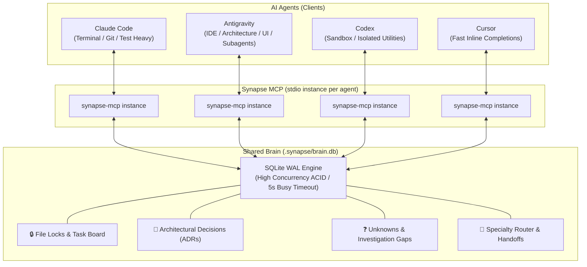

<div align="center">

# 🧠 Synapse MCP

**Unified Brain, Shared Memory, File Locks, and Task Board for Multi-Agent AI Development.**

[](https://www.typescriptlang.org/)
[](https://opensource.org/licenses/MIT)
[](https://modelcontextprotocol.io/)
[-orange.svg)](https://nodejs.org/)

[🇺🇸 English](README.md) • [🇧🇷 Português](README.pt-BR.md)

</div>

---

Work with **Claude Code**, **Codex**, **Antigravity**, and **Cursor** on the **same project simultaneously**, without collisions, lost context, or duplicated work.

---

## 🎯 The Problem

When running multiple AI coding agents on the same repository:
1. **Isolated OS Processes**: Each agent runs its own MCP server process over `stdio`. RAM is completely isolated.
2. **Context Blindness**: Claude Code in terminal has no idea what Antigravity just refactored or decided in the IDE.
3. **Collision & Race Conditions**: Two agents can edit the same files concurrently, overwriting each other's changes.
4. **Lack of Specialization**: Agents don't know who is best equipped for what task.

---

## 💡 The Solution

Synapse MCP connects all your agents to an **embedded SQLite WAL memory hub** located in `.synapse/brain.db` at your repository root. Zero external servers, zero background daemons, zero cloud dependencies.



---

## 🚀 Quick Start

### 1. Installation

```bash
git clone https://github.com/holaluiz/synapse-mcp.git
cd synapse-mcp
npm install
npm run build
```

### 2. Auto-Setup for All Agents

Inspired by REA's configuration engine, Synapse can auto-detect and register itself into your installed agents with a single command:
```bash
npm run setup
```
This safely inspects and updates:
- **Antigravity**: `~/.gemini/config/mcp_config.json`
- **Claude Code**: `~/.claude.json`
- **Codex**: `~/.codex/config.toml`
- **Cursor**: `~/.cursor/mcp.json`

*(Safety backups `.synapse.backup` are automatically created before any modification).*

### 3. Check System Status
```bash
npm run doctor
```

---

## 🛠️ Available MCP Tools

| Tool | Category | Description |
| :--- | :---: | :--- |
| `synapse_claim_task` | **Coordination** | Claims a task and locks specific file patterns (prevents other agents from editing). |
| `synapse_release_task` | **Coordination** | Completes a task, records summary, and releases file locks. |
| `synapse_get_tasks` | **Coordination** | Lists all active tasks, assigned agents, and currently locked files. |
| `synapse_record_decision` | **Memory** | Saves an Architectural Decision Record (ADR) so all agents respect technical choices. |
| `synapse_record_knowledge` | **Memory** | Records project conventions, API patterns, and configuration caveats. |
| `synapse_query_memory` | **Memory** | Searches decisions and knowledge base across the codebase. |
| `synapse_record_unknown` | **Ledger** | Flags an unexplained bug, missing requirement, or investigation gap for other agents. |
| `synapse_resolve_unknown` | **Ledger** | Closes an unknown gap with a verified explanation or fix. |
| `synapse_list_unknowns` | **Ledger** | Lists open or investigating gaps and their severity. |
| `synapse_handoff_task` | **Routing** | Transfers task ownership and file locks from one agent to another with handover notes. |
| `synapse_recommend_agent` | **Routing** | Consults the agent capability matrix to advise who should tackle a task. |
| `synapse_get_active_agents` | **Presence** | Shows which agents are currently active and their latest heartbeats. |

---

## 🤝 Example Multi-Agent Workflow

1. **Antigravity** opens the project in the IDE:
   - Calls `synapse_claim_task({ agent_name: "antigravity", title: "Build Auth & User Model", lock_patterns: ["src/auth/**", "src/models/**"] })`.
   - Records an ADR: `synapse_record_decision({ agent_name: "antigravity", title: "Use Argon2 for password hashing", decision: "Argon2id with salt length 16" })`.
   - Notices an edge case in JWT expiry and calls `synapse_record_unknown({ question: "Should refresh token rotate on every request?" })`.
   - Calls `synapse_handoff_task({ from_agent: "antigravity", to_agent: "claude-code", task_id: "task-123", handoff_notes: "Schema and routes written. Please write and execute integration tests." })`.

2. **Claude Code** in the terminal:
   - Calls `synapse_get_tasks()` and sees `task-123` assigned to it with locks already transferred.
   - Runs `npm test` in the terminal, verifies the suite, and resolves the edge case.
   - Calls `synapse_resolve_unknown({ unknown_id: "unk-456", resolution: "Rotates refresh token every 15 minutes." })`.
   - Calls `synapse_release_task({ task_id: "task-123", summary: "Integration tests passing. Git staged." })`.

---

## 📚 In-Depth Documentation

- [Architecture & Concurrency Guide](docs/architecture.md)
- [Complete Tools Reference](docs/tools-reference.md)
- [Multi-Agent Collaboration Recipes](docs/multi-agent-workflows.md)

---

## 📄 License

MIT © [Luiz / Um Cara Caramelo](https://github.com/holaluiz)
