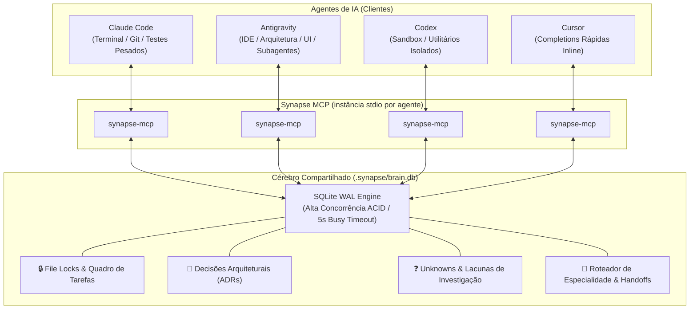

<div align="center">

# 🧠 Synapse MCP

**Cérebro Unificado, Memória Compartilhada, File Locks e Quadro de Tarefas para Desenvolvimento Multi-Agente com IA.**

[](https://www.typescriptlang.org/)
[](https://opensource.org/licenses/MIT)
[](https://modelcontextprotocol.io/)
[-orange.svg)](https://nodejs.org/)

[🇺🇸 English](README.md) • [🇧🇷 Português](README.pt-BR.md)

</div>

---

Trabalhe com **Claude Code**, **Codex**, **Antigravity** e **Cursor** no **mesmo projeto simultaneamente**, sem colisões de código, sem perda de contexto e sem retrabalho.

---

## 🎯 O Problema

Quando você conecta múltiplos agentes de IA no mesmo repositório:
1. **Processos Isolados no SO**: Cada agente executa seu próprio processo de servidor MCP via `stdio`. A memória RAM não é compartilhada.
2. **Cegueira de Contexto**: O Claude Code no terminal não tem a menor ideia do que o Antigravity acabou de refatorar ou decidir no IDE.
3. **Colisão e Race Conditions**: Dois agentes podem editar os mesmos arquivos ao mesmo tempo, sobrescrevendo alterações um do outro.
4. **Falta de Especialização**: Os agentes não sabem quem é o mais indicado para cada tipo de tarefa.

---

## 💡 A Solução

O **Synapse MCP** conecta todos os seus agentes a um **hub de memória SQLite WAL embutido** localizado em `.synapse/brain.db` na raiz do seu projeto. Zero servidores externos, zero daemons em segundo plano e zero dependências em nuvem.



---

## 🚀 Instalação Rápida

### 1. Clonar e Compilar

```bash
git clone https://github.com/holaluiz/synapse-mcp.git
cd synapse-mcp
npm install
npm run build
```

### 2. Configuração Automática nos Agentes

Inspirado no motor de configuração do REA, o Synapse detecta e registra a si mesmo em todos os agentes instalados no seu computador com um único comando:

```bash
npm run setup
```

Isso inspeciona e configura de forma segura e idempotente:
- **Antigravity**: `~/.gemini/config/mcp_config.json`
- **Claude Code**: `~/.claude.json`
- **Codex**: `~/.codex/config.toml`
- **Cursor**: `~/.cursor/mcp.json`

*(Backups de segurança `.synapse.backup` são criados automaticamente antes de qualquer alteração).*

### 3. Verificar Saúde do Sistema
```bash
npm run doctor
```

---

## 🛠️ Ferramentas MCP Disponíveis

| Ferramenta | Categoria | Descrição |
| :--- | :---: | :--- |
| `synapse_claim_task` | **Coordenação** | Reivindica uma tarefa e trava arquivos específicos (`lock_patterns`), impedindo outros agentes de editá-los. |
| `synapse_release_task` | **Coordenação** | Conclui ou libera a tarefa, registra um resumo e destrava os arquivos para os outros agentes. |
| `synapse_get_tasks` | **Coordenação** | Lista todas as tarefas ativas, quem está trabalhando nelas e quais arquivos estão travados no momento. |
| `synapse_record_decision` | **Memória** | Salva um *Architectural Decision Record* (ADR) para que todos os agentes respeitem as decisões de arquitetura. |
| `synapse_record_knowledge` | **Memória** | Salva convenções do projeto, padrões de API e pegadinhas de configuração. |
| `synapse_query_memory` | **Memória** | Busca decisões e conhecimentos registrados na base canônica do projeto. |
| `synapse_record_unknown` | **Ledger** | Registra um bug inexplicado, requisito faltante ou lacuna de investigação para outro agente resolver. |
| `synapse_resolve_unknown` | **Ledger** | Fecha uma lacuna com uma explicação ou correção verificada. |
| `synapse_list_unknowns` | **Ledger** | Lista todas as dúvidas e lacunas em aberto no projeto e suas severidades. |
| `synapse_handoff_task` | **Roteamento** | Passa a responsabilidade de uma tarefa (e seus locks) para outro agente com notas de transferência. |
| `synapse_recommend_agent` | **Roteamento** | Consulta a matriz de especialidade para recomendar qual IA é melhor para cada tarefa. |
| `synapse_get_active_agents` | **Presença** | Mostra quais agentes estão ativos no momento e seus últimos batimentos cardíacos (*heartbeats*). |

---

## 🤝 Exemplo de Fluxo Multi-Agente na Prática

1. **Antigravity** abre o projeto no IDE:
   - Chama `synapse_claim_task({ agent_name: "antigravity", title: "Criar Auth e Modelo de Usuário", lock_patterns: ["src/auth/**", "src/models/**"] })`.
   - Registra um ADR: `synapse_record_decision({ agent_name: "antigravity", title: "Usar Argon2 para hash de senha", decision: "Argon2id com salt length 16" })`.
   - Identifica uma dúvida sobre expiração de JWT e chama `synapse_record_unknown({ question: "O refresh token deve rotacionar a cada requisição?" })`.
   - Passa o bastão: `synapse_handoff_task({ from_agent: "antigravity", to_agent: "claude-code", task_id: "task-123", handoff_notes: "Rotas e schemas prontos. Escreva e execute a suíte de testes de integração." })`.

2. **Claude Code** no terminal:
   - Executa `synapse_get_tasks()` e visualiza a `task-123` atribuída a ele, com os locks já transferidos.
   - Roda `npm test` no terminal, valida a suíte e resolve a dúvida do token.
   - Chama `synapse_resolve_unknown({ unknown_id: "unk-456", resolution: "Rotaciona o refresh token a cada 15 minutos." })`.
   - Chama `synapse_release_task({ task_id: "task-123", summary: "Testes passando 100%. Código preparado no git." })`.

---

## 📚 Documentação Aprofundada

- [Guia de Arquitetura & Concorrência SQLite WAL](docs/architecture.md)
- [Referência Completa de Ferramentas](docs/tools-reference.md)
- [Receitas de Colaboração Multi-Agente](docs/multi-agent-workflows.md)

---

## 📄 Licença

MIT © [Luiz / Um Cara Caramelo](https://github.com/holaluiz)
