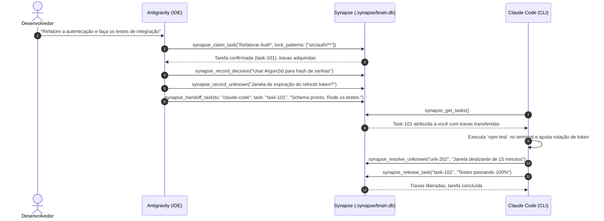

<div align="center">

# 🧠 Synapse MCP

**Coordene qualquer tarefa entre agentes de IA — da arquitetura do sistema aos testes de terminal.**

[](https://www.typescriptlang.org/)
[-339933?logo=node.js&logoColor=white)](https://nodejs.org/)
[](https://modelcontextprotocol.io/)
[](LICENSE)
[](SECURITY.md)
[](https://holaluiz.github.io/synapse-mcp/)

[🇺🇸 English](README.md) • [🇧🇷 Português](README.pt-BR.md) • [🌐 Live Website](https://holaluiz.github.io/synapse-mcp/)

</div>

---

Conecte **Claude Code**, **Antigravity**, **Codex** e **Cursor** para trabalhar no **mesmo repositório concorrentemente** — sem sobrescrever código, sem perder contexto arquitetural e sem trabalho duplicado.

> [!IMPORTANT]
> **Zero Daemons. Zero Nuvem. Zero Compilação Nativa C++.**
> O Synapse roda nativamente no motor `node:sqlite` do Node 22/24 em modo Write-Ahead Logging (WAL). Cada processo de agente se comunica diretamente com o arquivo `.synapse/brain.db` com concorrência ACID em microssegundos.

---

## ⚡ Instalação Rápida

```bash
# 1. Clonar e Compilar
git clone https://github.com/holaluiz/synapse-mcp.git
cd synapse-mcp
npm install
npm run build

# 2. Configurar automaticamente em todos os agentes detectados no seu PC
npm run setup

# 3. Verificar diagnósticos e saúde do sistema
npm run doctor
```

---

## 🔌 Clientes de IA Suportados

O Synapse detecta seus agentes instalados e configura de forma idempotente seus arquivos de registro com backups automáticos (`.synapse.backup`):

| Cliente | Interface | Caminho Nativo de Configuração | Configuração Automática | Status |
| :--- | :---: | :--- | :---: | :---: |
| **Antigravity** | IDE | `~/.gemini/config/mcp_config.json` | :white_check_mark: | Verificado |
| **Claude Code** | Terminal | `~/.claude.json` | :white_check_mark: | Verificado |
| **Codex** | CLI / Sandbox | `~/.codex/config.toml` | :white_check_mark: | Verificado |
| **Cursor** | IDE | `~/.cursor/mcp.json` | :white_check_mark: | Verificado |
| **OpenCode** | CLI | `~/.config/opencode/opencode.json` | :white_check_mark: | Suportado |
| **Windsurf** | IDE | `~/.codeium/windsurf/mcp_config.json` | Manual | Suportado |
| **VS Code** | IDE | `~/AppData/Roaming/Code/User/mcp.json` | Manual | Suportado |

*Consulte [docs/client-configuration.md](docs/client-configuration.md) para guias de configuração manual no Windows, macOS e Linux.*

---

## 🏗️ Arquitetura & Modelo de Concorrência

Quando múltiplos agentes rodam ao mesmo tempo, cada um inicia seu próprio processo filho `stdio`. O Synapse conecta esses processos isolados através de um banco de dados SQLite WAL embutido:

```text
  ┌─────────────────┐       ┌─────────────────┐       ┌─────────────────┐
  │   Antigravity   │       │   Claude Code   │       │      Codex      │
  │   (Agente IDE)  │       │ (Terminal CLI)  │       │(Sandbox Runner) │
  └────────┬────────┘       └────────┬────────┘       └────────┬────────┘
           │ stdio                   │ stdio                   │ stdio
           ▼                         ▼                         ▼
  ┌─────────────────┐       ┌─────────────────┐       ┌─────────────────┐
  │   Synapse MCP   │       │   Synapse MCP   │       │   Synapse MCP   │
  │   Instância 1   │       │   Instância 2   │       │   Instância 3   │
  └────────┬────────┘       └────────┬────────┘       └────────┬────────┘
           │                         │                         │
           └─────────────────────────┼─────────────────────────┘
                                     ▼
                    ┌─────────────────────────────────┐
                    │    .synapse/brain.db (SQLite)   │
                    │   PRAGMA journal_mode = WAL;    │
                    │   PRAGMA busy_timeout = 5000;   │
                    ├─────────────────────────────────┤
                    │ 🔒 File Locks & Quadro de Tarefas│
                    │ 📜 Decisões de Arquitetura (ADRs)│
                    │ ❓ Lacunas & Dúvidas (Unknowns)  │
                    │ 🧭 Roteador & Handoffs de Agentes│
                    │ 📊 Registro de Atividades Auditado│
                    └─────────────────────────────────┘
```

---

## 🛠️ Catálogo Completo de Ferramentas MCP

O Synapse expõe 12 ferramentas MCP tipadas para orquestração multi-agente:

### 1. Coordenação & Anti-Colisão
- **`synapse_claim_task`**: Reivindica uma tarefa e aplica travas consultivas em arquivos (ex: `["src/auth/**"]`). Rejeita com detalhes se outro agente já estiver editando a mesma área.
- **`synapse_release_task`**: Conclui ou libera uma tarefa, remove as travas de arquivos e anota um resumo do que foi entregue.
- **`synapse_get_tasks`**: Lista todas as tarefas em andamento, pendentes ou bloqueadas e quais arquivos estão travados no momento.

### 2. Memória Compartilhada & Decisões Arquiteturais
- **`synapse_record_decision`**: Grava um *Architectural Decision Record* (ADR) (contexto, decisão, trade-offs) para que nenhum agente desfaça uma escolha de projeto.
- **`synapse_record_knowledge`**: Salva convenções, padrões de API e pegadinhas de configuração.
- **`synapse_query_memory`**: Busca indexada ultra-rápida por palavras-chave ou categorias em toda a base de decisões e conhecimentos.

### 3. Dúvidas & Lacunas de Investigação (Inspirado no REA)
- **`synapse_record_unknown`**: Registra uma dúvida, bug inexplicado ou lacuna de especificação para que outro agente a assuma.
- **`synapse_resolve_unknown`**: Fecha a dúvida com a explicação ou correção verificada.
- **`synapse_list_unknowns`**: Lista todas as dúvidas abertas ordenadas por severidade (*critical*, *high*, *medium*, *low*).

### 4. Roteamento por Especialidade & Handoffs
- **`synapse_recommend_agent`**: Avalia o enunciado da tarefa contra a matriz de competências (Antigravity para UI/arquitetura no IDE, Claude Code para terminal/git/testes pesados, Codex para algoritmos isolados).
- **`synapse_handoff_task`**: Transfere a responsabilidade da tarefa e os locks de arquivos para outro agente com instruções detalhadas.
- **`synapse_get_active_agents`**: Informa quais agentes mandaram batimento cardíaco (*heartbeat*) nos últimos 15 minutos.

*Para ver os schemas completos e exemplos, consulte [docs/tools-reference.md](docs/tools-reference.md).*

---

## 🤝 Fluxo de Colaboração na Prática



---

## 🔒 Segurança & Privacidade Local-First

- **100% Local-First**: Nenhum byte de código ou memória sai da sua máquina. O banco reside em `.synapse/brain.db`.
- **Zero Telemetria**: Sem rastreadores ou chamadas para servidores externos.
- **Travas Não-Destrutivas**: O Synapse nunca altera permissões do sistema operacional nem esconde arquivos; os locks são barreiras consultivas transacionais no SQLite.
- **Backups Automáticos**: O instalador gera arquivos `.synapse.backup` antes de tocar em qualquer configuração.

*Consulte [SECURITY.md](SECURITY.md) para diretrizes de segurança.*

---

## 📚 Documentação Aprofundada

- 🏛️ [Guia de Arquitetura & Concorrência SQLite WAL](docs/architecture.md)
- 🛠️ [Referência Completa das Ferramentas MCP](docs/tools-reference.md)
- 🤝 [Receitas de Colaboração Multi-Agente](docs/multi-agent-workflows.md)
- 🔌 [Guia de Configuração dos Clientes](docs/client-configuration.md)
- 📜 [Diretrizes de Contribuição](CONTRIBUTING.md)
- 🤖 [Instruções para Agentes de IA](AGENTS.md)

---

## 📄 Licença

MIT © [Luiz / Um Cara Caramelo](https://github.com/holaluiz)
